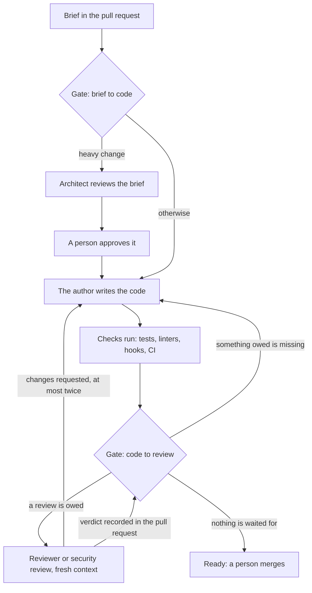

# SDLC Agents

**Whoever wrote the change does not decide how much checking it gets.**

Current models plan and write code well without being told how to think. What a better model does not fix is who checks whom. An author, human or model, is a poor judge of its own work, and should not be the one to decide how much checking that work gets. This project installs the few parts that settle that, and nothing else:

- **A brief before code.** One page at the top of the pull request: the goal, what is out of scope, checks that can be run, and the blast radius.
- **An independent reviewer before "ready".** A fresh context that sees the diff and the brief, not the author's reasoning, and cannot edit.
- **Gates that code enforces.** A script works out what each change owes and where it goes next, and a job on the pull request stays red until that is there. The author never picks its own checks.

[docs/architecture.md](./docs/architecture.md) explains how the parts fit together.

## How a change moves



The gate at "code to review" prints a block like this into the pull request:

```text
### Owed by this change

- Unit test: present (src/orders/total.test.ts). Path rule: src/orders/total.ts.
- User journey test: **MISSING**. Path rule: src/app/checkout/page.tsx.
- Security review: owed. Judge: p=0.81, at or above 0.3.
- Not owed: Database or integration test, API contract, Language check, Live model run

**Next: back to the author** (journey-test). Add what is missing, or write `Waive <item>: <reason>` in the pull request. No reviewer starts yet.
```

Not every change needs every kind of test, and few need a security review. The rules say which change owes what. Where a rule allows it, a run the author reports counts as the evidence, and the reviewer judges it. See [docs/gates.md](./docs/gates.md).

Not every change needs a reviewer either. It reads every change until a rule of yours names the places where it should, and a retro keeps that list honest against the merged history. See [docs/risk.md](./docs/risk.md).

The reviewer blocks only on what it can show and what matters now: a wrong result for a user, lost data, a failure in production, or an owed check that cannot catch its break. Smaller real defects travel with the approval as `worth_fixing`.

## What is in here

| Path | What it is |
|---|---|
| `roles/reviewer.md`, `roles/architect.md`, `roles/retro.md` | The three agent files. Each is at most 40 lines. |
| `gate/handover_gate.py` | The gate. Python 3.8+, standard library only, with its tests beside it. |
| `retro/risk_report.py` | The risk report: where merged changes later needed a fix, against the rule that says what the reviewer reads. Same requirements, tests beside it. |
| `templates/rules.json` | Starter rules: what is owed, decided by which paths, and which question goes to the judge. |
| `templates/brief.md`, `templates/pull_request_template.md` | The brief, and a pull request template that holds the brief, the gate's block and the verdicts. |
| `templates/CLAUDE.snippet.md` | The delivery contract: about a dozen lines for your `CLAUDE.md`. |
| `templates/lessons/` | One short, dated lessons file per role. See [docs/learnings.md](./docs/learnings.md). |
| `templates/fixes.json` | The file of confirmed fixes that the risk report counts from. It starts empty. |
| `ci/handover-gate.yml` | A workflow that runs the gate on every pull request, prints its block, and fails while something owed is not there. |
| `install.sh` | Copies all of the above into a repository. |
| `legacy/` | The earlier seven-agent pipeline, kept as it was. See below. |

## Install

```bash
git clone https://github.com/dsilahcilar/sdlc-agents.git
sdlc-agents/install.sh --target /path/to/your/repository
```

The installer copies files. It links nothing back to the checkout, so the install works the same on a laptop, in CI and in a cloud session. It writes the commit it came from to `.sdlc/VERSION`.

Then:

1. Edit `.sdlc/rules.json`. The path patterns are guesses at a common layout. Point them at where things live in your repository.
2. Paste `.sdlc/templates/CLAUDE.snippet.md` into your `CLAUDE.md`.
3. Try it on a branch: `python3 .sdlc/gate/handover_gate.py --base origin/main`.
4. Copy `.sdlc/templates/handover-gate.yml` to `.github/workflows/`, and make its check required before a merge.

The agent files use the subagent format of Claude Code. The gate, the rules and the templates are plain files and work with any tool.

## Enforced by default

The contract in `CLAUDE.md` tells the author to follow the gate, and the workflow holds the pull request to it. The job is red while owed evidence is missing, or while an owed review has no verdict in the pull request. The author records a review that ran with one line above its verdict:

```text
Verdict reviewer: approve, two notes fixed here
```

"Needs human approval" does not turn the job red. It is a note for the person who merges. A branch that started before the gate was installed is reported and not held.

To read what your rules would ask for on real pull requests before they hold anything, set `ENFORCE` to `"false"` in the workflow. A rule that has not been checked against real changes means little yet, and the starter patterns are guesses.

## The judge is optional

Path rules decide everything they can decide exactly. A rule may also carry one factual yes/no question for the cases paths cannot settle, such as "does this diff change who can read which user's data?". That question goes to a judge: any program that returns a probability. If the judge fails to answer, the item counts as owed. With no judge configured, only the path rules apply. The protocol is in [docs/gates.md](./docs/gates.md).

## The earlier pipeline

This project started as seven agents, one per phase of the work, each with its own prompt, task files and a skill loader. That pipeline is in [`legacy/`](./legacy/README.md), unchanged, and still installs with `legacy/install.sh`. It is no longer developed. [docs/migrating.md](./docs/migrating.md) maps each of its pieces to what replaces it and why.

## Tests

```bash
python3 -m unittest discover -s gate -p 'test_*.py'
python3 -m unittest discover -s retro -p 'test_*.py'
```
