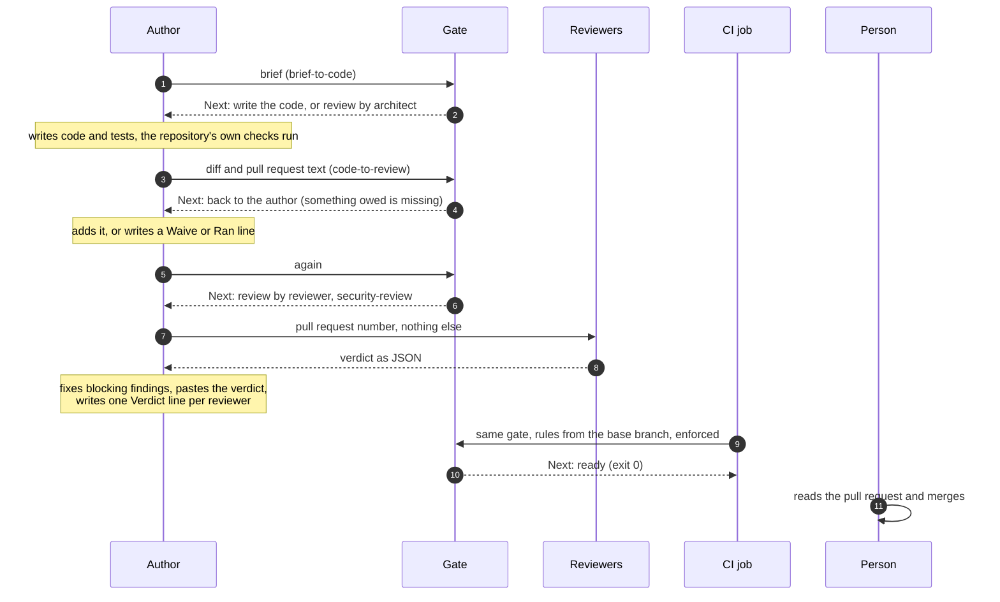
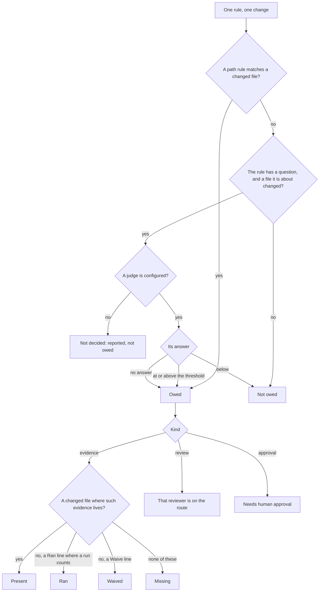
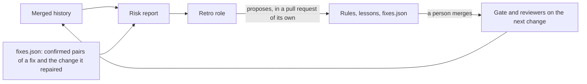

# Architecture

This page explains how the parts fit together and why each one is there. The details are in [gates.md](./gates.md) (the gate and its rules), [risk.md](./risk.md) (which changes the reviewer reads) and [learnings.md](./learnings.md) (how lessons are kept).

## The idea

One rule carries the whole design: **whoever did the work does not decide how much checking the work gets.**

Current models plan and write code well without being told how to think, so nothing here tells the author how to work. What a better model does not fix is that an author, human or model, is a poor judge of its own change. Three things follow from the rule, and they are all this project installs:

1. **A brief before code**, so there is something stated to check the change against.
2. **A gate at each handover**: a script that works out from the diff what the change owes and where it goes next. The author runs it and cannot argue with it.
3. **Reviewers in a fresh context**, started only when the gate names them, who see the pull request and not the author's reasoning, and who cannot edit.

Everything else stays with the repository: its tests, its linters, its CI, and the person who merges.

## The parts

| Part | What it is | Where it lives once installed | Who changes it |
|---|---|---|---|
| Delivery contract | About a dozen lines that tell the author what to do at each handover | `CLAUDE.md` | A person |
| Brief | One page: goal, what is out of scope, checks that can be run, blast radius | The top of the pull request | The author |
| Handover gate | A Python script, standard library only. Reads the diff, the rules and the pull request text. Prints a block and a "Next" line | `.sdlc/gate/handover_gate.py` | The installer |
| Rules | What is owed, by which paths, and which question goes to the judge | `.sdlc/rules.json` | You, through a pull request a person approves |
| Judge (optional) | Any program that answers one yes/no question with a probability | Yours to write | You |
| Reviewer, architect | Two agent files, read-only tools, a JSON verdict | `.claude/agents/` | The installer |
| Security review | The built-in `/security-review` of Claude Code, in a fresh context | Not installed here | |
| Lessons | One short, dated file per reviewing role | `.sdlc/lessons/` | The retro, through a pull request |
| Risk report | A script that reads the merged history and says where changes later needed a fix | `.sdlc/retro/risk_report.py`, `.sdlc/retro/fixes.json` | The installer, and the retro for the fixes file |
| Retro | An agent file that reads the report and proposes changes to the rules and lessons | `.claude/agents/retro.md` | The installer |
| CI job | A workflow that runs the gate on every pull request and holds it while something owed is not there | `.github/workflows/handover-gate.yml` | A person |
| The pull request | The record: the brief, the gate's block, the `Waive`, `Ran` and `Verdict` lines, each verdict as it came back | Your code host | The author |

There is no server, no database and no state outside the repository and the pull request. An install is a set of copied files, so it works the same on a laptop, in CI and in a cloud session.

## One change, start to finish



1. **The brief.** The author writes it at the top of the pull request and runs the gate at the `brief-to-code` handover. The starter rules put three questions about the brief to the judge: whether it names a check that can be run, whether the change is heavy enough for the architect (the shape of stored data, a contract, a new pattern), and whether a person should approve it before any code exists (access, payment, personal data, a destructive change). Without a judge these are reported as not decided.
2. **The code.** The author writes it however it likes. Tests, linters, hooks and CI run as they always did. Nothing here replaces them.
3. **The gate at `code-to-review`.** It compares the head of the branch with the point where it left the base branch, and gives every rule one state. Then it prints one of three "Next" lines:
   - **back to the author**: owed evidence is missing. No reviewer starts yet, because a review of a change that lacks its tests is a review to repeat.
   - **review by ...**: the reviewers that are owed and have no verdict in the pull request yet.
   - **ready**: nothing is waited for. The checks and the person who merges decide.
4. **The reviews.** Each reviewer starts in a fresh context with the pull request number only. It reads the brief, the block, the diff and the code around it, runs the checks the brief names, and returns JSON. A finding blocks only if the reviewer can show it and it matters now. The author fixes what blocks, pastes the verdict, and writes one line per reviewer: `Verdict reviewer: approve, two notes fixed here`.
5. **The CI job.** It runs the same gate on the same diff and text, with the gate and the rules taken from the base branch, and fails while the "Next" line is not "ready".
6. **The merge.** A person merges. Where the block says "Needs human approval", that person's decision is the approval.

## How the gate decides one item

Every rule is one item of one of three kinds: `evidence` (a kind of test, a contract file), `review` (a reviewer reads the change) or `approval` (a person decides).



Three properties matter more than the detail:

- **Code decides what it can decide exactly.** The judge is asked only about what paths cannot settle, and only when a file the question is about has changed.
- **No answer means the stricter route.** A judge that is down, slow or over its budget never lowers the scrutiny.
- **A sentence from the author is judged by someone else.** A `Waive` or `Ran` line answers an owed item and always brings the reviewer in to judge it.

## Who decides what

| Decision | Decided by |
|---|---|
| What a change owes | The rules: path rules first, then the judge |
| Whether an owed test would fail if the behaviour broke | The reviewer |
| Whether a waiver or a reported run holds | The reviewer |
| Which changes the standard reviewer reads | A rule (`code-review`), proposed by the retro from the merged history, merged by a person |
| What blocks | The reviewer, against a stated bar. After two rounds without approval the author stops and asks the person |
| A change to the gate, the rules, the lessons, the contract or the gate's workflow | A person ("Needs human approval") |
| The merge | A person |

The author decides how to build the change, and nothing in this table.

## Enforcement

The gate is enforced in two places.

**In the session**, by the delivery contract in `CLAUDE.md`: the author runs the gate before it calls a change ready and follows the "Next" line.

**On the pull request**, by the "Handover gate" job. It runs the gate with `--enforce`, which exits 1 while something owed is not there:

| Situation | The job |
|---|---|
| Owed evidence is missing, with no waiver | Red |
| An owed review has no `Verdict <reviewer>: ...` line in the pull request text | Red |
| Everything owed is there | Green |
| "Needs human approval" | Green. It is a note for the person who merges, and a job cannot give that approval |
| The gate cannot run, for example on a broken rules file | Red, in either mode |
| The branch left the base branch before the gate was installed | Green, with the block and a line that says it is reported and not held |

Editing the pull request text runs the job again, so a `Waive`, `Ran` or `Verdict` line turns it green without a new commit.

Two things are yours to set:

- **Require the check.** A red job that is not a required check can still be merged past. Make "What this change owes" required in branch protection or a ruleset.
- **Report only.** Set `ENFORCE` to `"false"` in the workflow to print the block and hold nothing. That is useful for reading what new rules would ask for on real pull requests before they bind.

## The learning loop

A rule that nobody revisits goes stale, and a reviewer on every change is the largest running cost of the workflow. The loop keeps both honest against what happened to merged changes.



- The **risk report** counts, per folder and per size, how often merged changes later needed a fix, and checks the reviewer's rule against that.
- The **retro** reads the report and proposes one step on a ladder for each thing it finds: a check in code if it can be one, a gate rule if not, and one or two dated lines in one role's lessons file as the last resort.
- **Lessons** are short, dated and expiring. A role names the entries it used in its verdict, and an entry leaves when a check covers it or after 90 days without a use.

## Trust boundaries

The pull request is written by the party being checked, so each part is built around what that party can and cannot influence.

- **The reviewers are read-only and start cold.** They get the pull request number and read the rest themselves. They do not see the author's reasoning, and they cannot fix what they find.
- **In CI the gate and the rules come from the base branch.** A pull request cannot loosen the rules that judge it.
- **The files that decide the checking need a person.** The starter rules ask for a human approval when the gate, the rules, the lessons, the fixes file, the gate's workflow, `CLAUDE.md` or `.claude/` change.
- **The pull request text never reaches a shell.** The workflow passes it through the environment and a file.
- **The judge can be talked to.** It reads a diff the author wrote. Where a miss would be expensive, use a path rule, which cannot be argued with.
- **A `Verdict` line is the author's record.** The gate checks that it is there, not that a review ran. The verdict pasted under it and the person who merges are the check on that, as they are for a `Waive` line.
- **A pull request that edits the gate's workflow runs its own copy.** GitHub runs a workflow file as the pull request has it. Such a pull request shows "Needs human approval". To close the gap fully, run the gate as a required workflow from a repository ruleset, which a pull request cannot edit.

## What is deliberately not here

- **No planning or coding agent, no task files, no skill loader.** The session that writes the brief writes the code. An earlier version of this project gave every phase its own agent, and it is kept in [`legacy/`](../legacy/README.md).
- **No test runner.** Which existing tests run is CI's question. The gate answers which tests a change must add.
- **No automatic merge and no automatic approval.** The gate can add checking and never removes a person's decision.
- **No hidden memory.** Lessons are files in the repository that change through pull requests.

## This repository

```text
gate/         the handover gate and its tests
retro/        the risk report and its tests
roles/        reviewer.md, architect.md, retro.md
templates/    rules.json, brief.md, pull_request_template.md, CLAUDE.snippet.md, lessons/, fixes.json
ci/           handover-gate.yml, the workflow template
docs/         this page, gates.md, risk.md, learnings.md, migrating.md
install.sh    copies the above into a repository
legacy/       the earlier seven-agent pipeline, kept as it was
```
