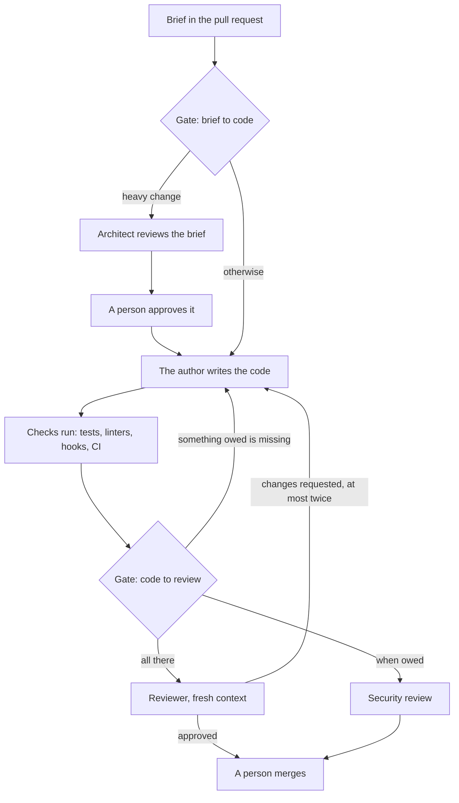

# SDLC Agents, version 2

**Keep the gates, drop the scripts.**

Version 1 gave each phase of the work its own agent and told each one how to think: seven prompts, a tree of task files, a skill loader. Current models plan and code well without that, and the long prompts now cost more than they prevent.

What a better model does not fix is who checks whom. An author, human or model, is a poor judge of its own work, and should not be the one to decide how much checking that work gets. Version 2 keeps that part of version 1 and nothing else:

- **A brief before code.** One page at the top of the pull request: the goal, what is out of scope, checks that can be run, and the blast radius.
- **An independent reviewer before "ready".** A fresh context that sees the diff and the brief, not the author's reasoning, and cannot edit.
- **Gates that code enforces.** A script works out what each change owes and where it goes next. The author never picks its own checks.

## How a change moves



The gate at "code to review" prints a block like this into the pull request:

```text
### Owed by this change

- Unit test: present (src/orders/total.test.ts). Path rule: src/orders/total.ts.
- User journey test: **MISSING**. Path rule: src/app/checkout/page.tsx.
- Security review: owed. Judge: p=0.81, at or above 0.3.
- Not owed: Database or integration test, API contract, Language check, Live model run

**Next: back to the author** (journey-test). Add what is missing, or write `Waive <item>: <reason>` in the pull request. No reviewer starts yet.
```

Not every change needs every kind of test, and few need a security review. The rules say which change owes what. See [docs/gates.md](./docs/gates.md).

## What is in here

| Path | What it is |
|---|---|
| `roles/reviewer.md`, `roles/architect.md` | The two agent files. Each is under 40 lines. |
| `gate/handover_gate.py` | The gate. Python 3.8+, standard library only, with its tests beside it. |
| `templates/rules.json` | Starter rules: what is owed, decided by which paths, and which question goes to the judge. |
| `templates/brief.md`, `templates/pull_request_template.md` | The brief, and a pull request template that holds the brief, the gate's block and the verdicts. |
| `templates/CLAUDE.snippet.md` | The delivery contract: about a dozen lines for your `CLAUDE.md`. |
| `templates/lessons/` | One short, dated lessons file per role. See [docs/learnings.md](./docs/learnings.md). |
| `ci/handover-gate.yml` | A workflow that prints the gate's block on every pull request and blocks nothing. |
| `install.sh` | Copies all of the above into a repository. |

## Install

```bash
git clone https://github.com/dsilahcilar/sdlc-agents.git
sdlc-agents/v2/install.sh --target /path/to/your/repository
```

The installer copies files. It links nothing back to the checkout, so the install works the same on a laptop, in CI and in a cloud session. It writes the commit it came from to `.sdlc/VERSION`.

Then:

1. Edit `.sdlc/rules.json`. The path patterns are guesses at a common layout. Point them at where things live in your repository.
2. Paste `.sdlc/templates/CLAUDE.snippet.md` into your `CLAUDE.md`.
3. Try it on a branch: `python3 .sdlc/gate/handover_gate.py --base origin/main`.

Version 2 targets Claude Code. The agent files use its subagent format. The gate, the rules and the templates are plain files and work with any tool.

## Start in shadow

Run the gate for a week or two without acting on it. Read what it would have asked for on real pull requests, fix the rules where it is wrong, and only then let the "Next" line decide. A rule that has not been checked against real changes means nothing yet.

## The judge is optional

Path rules decide everything they can decide exactly. A rule may also carry one factual yes/no question for the cases paths cannot settle, such as "does this diff change who can read which user's data?". That question goes to a judge: any program that returns a probability. If the judge fails to answer, the item counts as owed. With no judge configured, only the path rules apply. The protocol is in [docs/gates.md](./docs/gates.md).

## Coming from version 1

Version 1 is still in this repository, unchanged, in `agents/`, `tools/` and the root `install.sh`. [docs/migrating-from-v1.md](./docs/migrating-from-v1.md) maps each version 1 piece to what replaces it and why.

## Tests

```bash
python3 -m unittest discover -s v2/gate -p 'test_*.py'
```
